  <picture>
    <source media="(prefers-color-scheme: dark)" srcset="assets/chud-wojack.svg" />
    <source media="(prefers-color-scheme: light)" srcset="assets/chud-wojack-light.svg" />
    
  </picture>

  

  <picture>
    <source media="(prefers-color-scheme: dark)" srcset="assets/title-bot.svg" />
    <source media="(prefers-color-scheme: light)" srcset="assets/title-bot-light.svg" />
    
  </picture>

CS student, 3rd semester at MNS UET Multan. I build things that actually work and I am looking for an ML/AI internship.

  <picture>
    <source media="(prefers-color-scheme: dark)" srcset="assets/pointing-wojack.svg" />
    <source media="(prefers-color-scheme: light)" srcset="assets/pointing-wojack-light.svg" />
    
  </picture>

  <picture>
    <source media="(prefers-color-scheme: dark)" srcset="assets/title-talk.svg" />
    <source media="(prefers-color-scheme: light)" srcset="assets/title-talk-light.svg" />
    
  </picture>

  
  
  

or just mail me: <a href="mailto:fahadkhannn90@gmail.com">fahadkhannn90@gmail.com</a>

  <picture>
    <source media="(prefers-color-scheme: dark)" srcset="assets/title-right-now.svg" />
    <source media="(prefers-color-scheme: light)" srcset="assets/title-right-now-light.svg" />
    
  </picture>

-  **GitLab:** contributing, because free swag is free swag. My first MR is open: a docs fix in GitLab's language server repo, [!4804](https://gitlab.com/gitlab-org/editor-extensions/gitlab-lsp/-/merge_requests/4804). My [contributor profile](https://contributors.gitlab.com/users/Burry071).
-  **Hacktoberfest:** 2026, finished it. Got the sticker pack, the certificate, and the DEV badge.
- ♞ **Chess:** building a tiny chess engine in 4 KB of Python for a $500 bounty. Yes, there will be chess on this profile soon.
- 🎓 **Internships:** applying for ML research internships. Fully funded ones only. I have bills to not pay.

  <picture>
    <source media="(prefers-color-scheme: dark)" srcset="assets/title-solo.svg" />
    <source media="(prefers-color-scheme: light)" srcset="assets/title-solo-light.svg" />
    
  </picture>

  <strong>Sleeve</strong> - an Android app that downloads media. It is a fork of Seal. I built the download engine and a bunch of stuff on top of it. No ads, no tracking, no accounts. A fork, not something I made from zero, just saying it straight. <a href="https://github.com/Burry071/sleeve">Repo</a>

  
  
  
  

  <picture>
    <source media="(prefers-color-scheme: dark)" srcset="assets/title-hackathons.svg" />
    <source media="(prefers-color-scheme: light)" srcset="assets/title-hackathons-light.svg" />
    
  </picture>

- **AI Tabib** — Google Gen AI Academy, Meet the Builders. I got annoyed that health advice in Urdu is either missing or garbage, so I made an AI that answers in Urdu and English. React, FastAPI, Gemini 2.0 Flash, Google Cloud Run. [Live](https://fahadiirshad04-ai-tabib.hf.space/) 
- **LAND JEZERO** — NASA Space Apps 2026, Multan. NASA said land on Mars. So I made a game where you land on Mars. On real Jezero Crater terrain from NASA, not a made up map. Submitted for judging. [Play it](https://burry071.github.io/land-jezero/) · [Repo](https://github.com/Burry071/land-jezero) 
- **Verso** — Hacktoberfest 2026, DEV Week 4. The back of the photo: five answers on one on-device Gemma 4 card. No internet permission. [Repo](https://github.com/Burry071/verso) 
- **Sift** — Hacktoberfest 2026, DEV Week 3. The junk drawer that files itself. On-device Gemma 4, no internet permission. [Repo](https://github.com/Burry071/sift) 

Same on-device series, also Gemma running fully offline: [Gazette](https://github.com/Burry071/gazette) and [Evenlight](https://github.com/Burry071/evenlight).

  <picture>
    <source media="(prefers-color-scheme: dark)" srcset="assets/title-weapons.svg" />
    <source media="(prefers-color-scheme: light)" srcset="assets/title-weapons-light.svg" />
    
  </picture>

  <picture>
    <source media="(prefers-color-scheme: dark)" srcset="assets/title-numbers.svg" />
    <source media="(prefers-color-scheme: light)" srcset="assets/title-numbers-light.svg" />
    
  </picture>

  
  

  

  <picture>
    <source media="(prefers-color-scheme: dark)" srcset="assets/title-snake.svg" />
    <source media="(prefers-color-scheme: light)" srcset="assets/title-snake-light.svg" />
    
  </picture>

<picture>
  <source media="(prefers-color-scheme: dark)" srcset="https://raw.githubusercontent.com/Burry071/Burry071/output/github-contribution-grid-snake-dark.svg" />
  <source media="(prefers-color-scheme: light)" srcset="https://raw.githubusercontent.com/Burry071/Burry071/output/github-contribution-grid-snake.svg" />
  
</picture>

  <picture>
    <source media="(prefers-color-scheme: dark)" srcset="assets/title-drawer.svg" />
    <source media="(prefers-color-scheme: light)" srcset="assets/title-drawer-light.svg" />
    
  </picture>

- [Hopehunter](https://github.com/Burry071/hopehunter) - local-first opportunity finder, one Python file.
- [mobile-production-skills](https://github.com/Burry071/mobile-production-skills)

